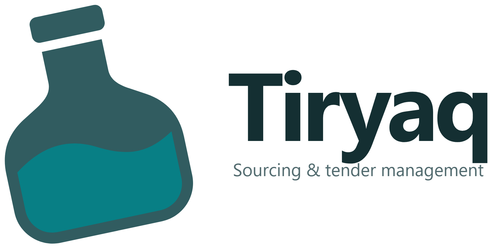
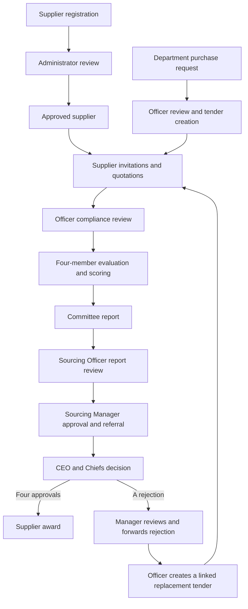

<div align="center">
  

  <h1>TIRYAQ</h1>
  <p><strong>Sourcing &amp; Tender Management System</strong></p>
  <p>A connected purchasing process for pharmaceutical companies, from purchase request to supplier award.</p>

  <p>
    <a href="#about-tiryaq">About</a> ·
    <a href="#key-features">Features</a> ·
    <a href="#procurement-workflow">Workflow</a> ·
    <a href="#getting-started">Getting started</a> ·
    <a href="#our-team">Our team</a>
  </p>
</div>

> **New to the code?** Start with the [code guide](CODE-GUIDE.md): folder map, how a request flows through the code, and where each feature lives.

> **Testing branch:** Use `ghaith-changes` for the latest AI Intelligence and committee edit-cycle changes. Follow the complete [tester setup guide](VLLM-SETUP.md#3-step-by-step-setup-after-cloning-from-github), including database migrations and Groq/Qwen 3.8 configuration.

## About TIRYAQ

TIRYAQ is a web platform designed to help pharmaceutical companies manage purchasing requests, supplier participation and tender decisions in one place.

Procurement teams often work across email, paper forms and separate spreadsheets. This makes it difficult to follow approvals, compare quotations consistently and understand how a supplier was selected. TIRYAQ brings these steps into a shared workflow with clear responsibilities for each participant.

Our goal is to make pharmaceutical sourcing easier to manage and easier to review. Departments describe what they need, suppliers submit their offers, committees evaluate the evidence, and decision makers can follow the recommendation through to the final award.

The platform supports procurement categories including pharmaceuticals, laboratory supplies, medical equipment, IT, packaging and professional services.

## Key features

| Area | What TIRYAQ provides |
|---|---|
| Supplier onboarding | Company registration, document uploads, administrator review and approval |
| Purchase requests | Department requests with item quantities, specifications and review feedback |
| Tender management | Category-based supplier invitations, opening and closing dates, and offer rounds |
| Supplier quotations | Item prices, tax, additional costs, delivery terms and supporting documents |
| Offer review | Compliance decisions before eligible offers move to committee evaluation |
| Committee evaluation | Four member weight confirmations, independent financial and technical marks, ranking and tie resolution |
| Management approval | Officer report review, manager decisions and referral to the final committee |
| Final decisions | Four CEO & Chiefs approvals for an award, with a rejection and replacement-tender path |
| Communication | Record-linked clarifications, notifications and role-specific workspaces |
| Reports | Committee reports, PDF downloads and selected Excel exports |
| AI assistance | vLLM / OpenAI-compatible comparisons, workspace help and report assistance, subject to validation and human review |
| Access and usability | ASP.NET Core Identity, optional face sign-in and passkeys, responsive layouts, voice search and QR detail links |

AI suggestions support the review process. Recorded committee marks determine the ranking, and authorized users retain responsibility for approvals and the final decision.

## Procurement workflow



The normal path requires three compliant suppliers. The system supports up to four offer rounds; a final-round shortfall requires a written reason. Evaluation members confirm their percentages before scoring every eligible offer. The highest average total leads, and tied leaders require a unanimous committee decision.

Open clarifications can pause progression. Reports can return for review, while a final-committee rejection preserves the original decision history and allows a linked replacement tender.

## User roles

| Role | Main responsibility |
|---|---|
| Administrator | Manage accounts and departments, and review supplier applications |
| Department | Submit purchase requirements and respond to requested changes |
| Supplier | Maintain company information, respond to invitations and submit quotations |
| Sourcing Officer | Review requests, prepare tenders, check offer compliance and review committee reports |
| Evaluation Committee | Confirm evaluation weights and independently score the offers |
| Sourcing Manager | Review recommendations, record decisions and refer approved cases |
| CEO & Chiefs / Top Committee | Review the nominated offer and record the final approvals or rejection |

Both committees use four distinct member positions. Permissions and record visibility depend on the user's role and assignment.

## Technology stack

| Layer | Technologies |
|---|---|
| Application | C#, ASP.NET Core MVC, .NET 10 |
| Database | Microsoft SQL Server, Entity Framework Core with Code First migrations |
| Authentication | ASP.NET Core Identity, WebAuthn passkeys, optional face verification |
| Interface | Razor views, HTML, CSS, JavaScript and Bootstrap |
| AI | vLLM (`Qwen/Qwen3-8B-AWQ` on GPU) or any OpenAI-compatible `/v1/chat/completions` API key |
| Documents | PDFsharp/MigraDoc for PDFs, ClosedXML for Excel exports |
| Additional tools | QRCoder, browser speech recognition and face-api.js |

## Getting started

### Requirements

- .NET 10 SDK.
- SQL Server accessible from your development machine.
- Visual Studio with .NET 10 support, or a terminal and your preferred editor.
- vLLM (Docker + WSL 2 on NVIDIA GPU) or an OpenAI-compatible API key if you want to use the AI features (see `VLLM-SETUP.md`).

### 1. Clone the application branch

```powershell
git clone --branch ghaith-changes https://github.com/saifkhatatbeh17-droid/sourcing-tender-management-system.git
cd sourcing-tender-management-system
```

Open `SourcingTenderManagement.CodeFirst.sln` in Visual Studio, or continue with the commands below.

### 2. Configure the database

The default connection uses SQL Server on `localhost` with Windows Authentication. To use a different instance, create `appsettings.Local.json` in the project root:

```json
{
  "ConnectionStrings": {
    "DefaultConnection": "Server=localhost;Database=SourcingTenderManagementCodeFirst;Trusted_Connection=True;TrustServerCertificate=True;"
  }
}
```

This local configuration file is ignored by Git. The connection can also be supplied through the `ConnectionStrings__DefaultConnection` environment variable.

### 3. Restore dependencies and apply migrations

```powershell
dotnet tool restore
dotnet restore
dotnet ef database update
```

Entity Framework migrations create and update the database schema. Database records, local demo accounts and private uploaded documents are not included in a Git clone.

### 4. Create your administrator

```powershell
.\scripts\create-admin.ps1 -Email admin@example.com
```

The script prompts for a password. No shared default administrator password is stored in the repository.

After signing in as administrator, create a department and the required staff accounts. Assign one active user to each of the four evaluation positions and each of the four Top Committee positions. Suppliers register through the public registration page and require administrator approval.

### 5. Run the application

```powershell
dotnet dev-certs https --trust
dotnet run --launch-profile https
```

Open [https://localhost:7130](https://localhost:7130).

For HTTP development, run `dotnet run --launch-profile http` and open [http://localhost:5072](http://localhost:5072). Face and passkey features depend on browser, device, permissions and secure-context support; use HTTPS for their setup and testing.

### Optional: enable AI (vLLM GPU or Cloud API Key)

The application uses **vLLM** (`Qwen/Qwen3-8B-AWQ` with thinking disabled) or any OpenAI-compatible `/v1/chat/completions` API key. See `VLLM-SETUP.md` for full setup instructions:

- **Local NVIDIA GPU (e.g., 64 GB RAM + RTX 3070 8 GB VRAM):**
  ```powershell
  .\scripts\start-vllm-3070.ps1
  ```
- **Cloud API Key (for lightweight or non-GPU PCs):** Add a `Vllm` section to `appsettings.Local.json`:
  ```json
  {
    "Vllm": {
      "BaseUrl": "https://api.groq.com/openai/v1",
      "Model": "qwen/qwen3.8-27b",
      "ApiKey": "YOUR_API_KEY",
      "EnableThinking": false
    }
  }
  ```

Committee reports continue to fall back to recorded scoring and quotation facts when the AI narrative is unavailable or cannot be verified.

## Project structure

```text
Controllers/       MVC endpoints and role workflows
Models/            Entities, forms and page models
Data/              Identity users, database context and EF migrations
Services/          Evaluation, reporting, AI and committee services
Views/             Razor pages and shared components
ViewComponents/    Reusable server-rendered UI components
wwwroot/           Stylesheets, scripts, images and browser assets
Checks/            Workflow, authorization, reporting and regression checks
scripts/           Database setup and administrator creation
```

Browse the [application source](https://github.com/saifkhatatbeh17-droid/sourcing-tender-management-system/tree/main) for the current implementation.

## Development checks

Run these commands from the application checkout:

```powershell
dotnet build
dotnet ef migrations has-pending-model-changes
```

The repository also includes isolated workflow checks:

```powershell
python Checks/procurement-entry-checks.py
python Checks/all-offer-scoring-checks.py
python Checks/full-qa-checks.py
```

These runners require Python 3, .NET and a local SQL Server account allowed to create and remove their disposable test databases. They cover procurement entry, scoring, report handling and rejection/replacement scenarios. Browser permissions, physical biometric hardware and real AI output require separate testing.

## Our team

| Team member | Role |
|---|---|
| **Saif Khatatbeh** | Scrum Master |
| **Taimaa Freahat** | Product Owner |
| **Anas Ghawanmeh** | Quality Assurance (QA) |
| **Mohammad Mustafa** | Developer |
| **Gaith Ammoureh** | Developer |
| **Yasmeen Talafha** | Developer |
| **Amani Azzam** | Developer |

Together, we are building TIRYAQ to give procurement teams a clear process from the first request to the final supplier decision.
